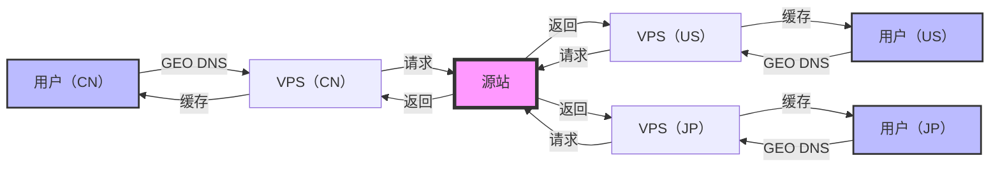

## 起因

出于科学上网的目的，购买了挺多优质线路的 VPS，但是流量根本用不完，太浪费了。于是想到可以用这些 VPS 搭建一个 CDN 系统，用于加速自己的网站。

## 方案探索

首先当然是去 Github 上找一些开源的项目，看看有没有现成的解决方案。但是找了一圈，发现这种项目挺少的，倒是找到 GoEdge 这种整套解决方案的，但是看了一下文档，感觉挺复杂的。于是打算自己基于一些现成的组件来手撸一个简易版的 CDN 系统。

## 架构设计

我设想中的架构是这样的：

- 首先这些优质线路的 VPS 作为流量入口，通过 GEO DNS 解析，将用户请求分发到最近的 VPS。
- VPS 如果有缓存，直接返回缓存内容，如果没有缓存，请求源站获取内容，然后返回给用户，并缓存到本地。
- 为了区分动态请求和静态请求，需要单独配置 CDN 域名，动态请求直接转发到源站，静态请求走缓存。

下面是整个系统的架构图：



## Caddy 前置与自动 HTTPS

首先每个 VPS 上都需要安装 Caddy 作为前置，用于自动申请 HTTPS 证书，以及转发请求到源站或者缓存。这里 Caddy 会区分动态请求和静态请求，动态请求直接转发到源站，静态请求走缓存。Nginx 其实也可以，只是 Nginx 自动申请 HTTPS 证书比较麻烦。Caddy 的配置如下：

```Caddyfile
{
 admin :2019
 https_port 8443
 http_port 8080
 email xxx@gmail.com # 这里填写你的邮箱
 acme_dns cloudflare xxx # 这里填写你的 Cloudflare API Token
 acme_ca https://acme.zerossl.com/v2/DV90
 acme_eab {
  key_id xxx # 这里填写你的 ZeroSSL Key ID
  mac_key xxx # 这里填写你的 ZeroSSL MAC Key
 }
 servers {
  listener_wrappers {
   proxy_protocol
   tls
  }
 }
 layer4 {
  :443 {
   @secure_cdn tls sni cdn.xxx.com # 这里填写你的 CDN 域名，我们要转发到缓存服务器
   route @secure_cdn {
    proxy {
     proxy_protocol v2
     upstream 127.0.0.1:8443
    }
   }
   @secure tls # 其他动态请求直接转发到源站
   route @secure {
    proxy {
     proxy_protocol v2
     upstream xxx:443
    }
   }
  }
 }
 storage s3 { # 为了防止每个VPS都去申请证书，我们使用 S3 存储证书
  host xxx
  bucket xxx
  access_id xxx
  secret_key xxx
 }
}
cdn.xxx.com { # CDN 域名转发到缓存服务器，同时为了对 cdn.xxx.com 自动申请证书
 reverse_proxy http://127.0.0.1:8444
}
```

其中 caddy 需要自行构建，以包含一些必要的插件：

```Dockerfile
FROM caddy:builder AS builder
ENV CADDY_VERSION master
RUN xcaddy build \
    --with github.com/caddy-dns/cloudflare \
    --with github.com/mholt/caddy-l4/layer4 \
    --with github.com/mholt/caddy-l4/modules/l4tls \
    --with github.com/mholt/caddy-l4/modules/l4proxyprotocol \
    --with github.com/mholt/caddy-l4/modules/l4proxy \
    --with github.com/mholt/caddy-l4/modules/l4http \
    --with github.com/ss098/certmagic-s3 \
    --with github.com/quic-go/quic-go=github.com/WeidiDeng/quic-go@shutdown-fix

FROM caddy
COPY --from=builder /usr/bin/caddy /usr/bin/caddy
```

## 缓存配置方案

在整个方案设计中，我调研了多种缓存方案，由于 VPS 的内存都不大，所以只考虑文件缓存而不是内存缓存。

### 使用 Caddy 缓存插件作为缓存

- [cache-handler](https://github.com/caddyserver/cache-handler)，这个插件是 Caddy 官方的缓存插件，支持多种存储后端。
  - [Nuts](https://docs.souin.io/docs/storages/nuts/)：支持文件缓存，但是测试过程中老是遇到连接挂起的问题，官方也有相关 issue，<https://github.com/caddyserver/cache-handler/issues/90>，但是似乎并没有解决。
  - [Badger](https://docs.souin.io/docs/storages/badger/)：也是支持文件缓存，但是使用过程中内存占用过高，老是 OOM 导致进程被杀，也没有找到限制内存的参数，官方也有很多相关 issue，但是也没有好的解决方案。
- [cdp-cache](https://github.com/sillygod/cdp-cache)：这个插件是第三方开发者开发的，支持文件缓存，但是测试过程中也发现连接挂起的问题，并且似乎也没有遵守 RFC 7234 规范。

### 使用 [varnish](https://varnish-cache.org/) 作为缓存中间件

这个貌似是一个比较成熟的缓存方案，但是看起来挺复杂的，而且我也没有使用过，所以暂时没有考虑。

### 使用 Nginx 作为缓存

这个方案是我最终选择的，因为 Nginx 作为一个成熟的 Web 服务器，缓存功能也是非常强大的。Nginx 的配置如下：

- nginx.conf

```nginx
user www-data;
worker_processes auto;
pid /run/nginx.pid;
include /etc/nginx/modules-enabled/*.conf;

events {
    worker_connections 10240;
    multi_accept on;
}
http {
    map $request_method $cmp_run_if {
        default 0;
        PURGE 1;
    }

    proxy_cache_path /data/cache levels=1:2 keys_zone=cache:64m inactive=1d max_size=2g; # 配置缓存

    sendfile on;
    tcp_nopush on;
    types_hash_max_size 2048;


    include /etc/nginx/mime.types;
    default_type application/octet-stream;


    ssl_protocols TLSv1 TLSv1.1 TLSv1.2 TLSv1.3;
    ssl_prefer_server_ciphers on;


    access_log /var/log/nginx/access.log;
    error_log /var/log/nginx/error.log;


    gzip on;


    map $http_upgrade $connection_upgrade {
        default upgrade;
        '' close;
    }
    include /etc/nginx/conf.d/*.conf;
    include /etc/nginx/sites-enabled/*;
}

```

- default.conf

```nginx
server {
    listen 8444;
    location / {
        proxy_pass https://xxx.com;
        proxy_set_header Host $http_host;
        proxy_set_header X-Forwarded-For $proxy_add_x_forwarded_for;
        proxy_set_header X-Forwarded-Proto $scheme;
        add_header X-Proxy-Cache $upstream_cache_status; # 添加缓存状态头
        proxy_cache cache; # 使用缓存
        proxy_cache_key https://$host$request_uri; # 缓存 key
        proxy_buffering on;
        proxy_cache_valid 200 302 1d; # 缓存 200 和 302 状态码的响应 1 天
        proxy_cache_valid any 1m; # 缓存其他状态码的响应 1 分钟
    }
}
```

由于需要主动清除缓存，需要自行构建 Nginx 镜像，以包含 `nginx-cache-purge` 工具：

```Dockerfile
FROM nginx
RUN curl -fL "$(curl -fsS https://api.github.com/repos/magiclen/nginx-cache-purge/releases/latest | sed -r -n 's/.*"browser_download_url": *"(.*\/nginx-cache-purge_'$(uname -m)')".*/\1/p')" -O && mv nginx-cache-purge_$(uname -m) /usr/local/bin/nginx-cache-purge && chmod +x /usr/local/bin/nginx-cache-purge
```

## GEO DNS 解析方案

国内很多云服务商都支持按照国家和地区进行解析，即不同国家或地区对 DNS 解析返回不同结果，比如阿里云、腾讯云、华为云等。对比了一圈，发现免费的还是华为云最强大，所以我选择了华为云的 GEO DNS 服务。

## 缓存测试

当一切都配置好之后，终于可以开始测试了，以本站为例，先使用 `curl` 进行测试，首先是第一次访问：

```bash
❯ curl -vvv https://blog.long2ice.io -X HEAD
Warning: Setting custom HTTP method to HEAD with -X/--request may not work the
Warning: way you want. Consider using -I/--head instead.
* Host blog.long2ice.io:443 was resolved.
* IPv6: (none)
* IPv4: 198.18.10.130
*   Trying 198.18.10.130:443...
* Connected to blog.long2ice.io (198.18.10.130) port 443
* ALPN: curl offers h2,http/1.1
* (304) (OUT), TLS handshake, Client hello (1):
*  CAfile: /etc/ssl/cert.pem
*  CApath: none
* (304) (IN), TLS handshake, Server hello (2):
* (304) (IN), TLS handshake, Unknown (8):
* (304) (IN), TLS handshake, Certificate (11):
* (304) (IN), TLS handshake, CERT verify (15):
* (304) (IN), TLS handshake, Finished (20):
* (304) (OUT), TLS handshake, Finished (20):
* SSL connection using TLSv1.3 / AEAD-AES128-GCM-SHA256 / [blank] / UNDEF
* ALPN: server accepted h2
* Server certificate:
*  subject: CN=blog.long2ice.io
*  start date: Oct 11 00:00:00 2024 GMT
*  expire date: Jan  9 23:59:59 2025 GMT
*  subjectAltName: host "blog.long2ice.io" matched cert's "blog.long2ice.io"
*  issuer: C=AT; O=ZeroSSL; CN=ZeroSSL ECC Domain Secure Site CA
*  SSL certificate verify ok.
* using HTTP/2
* [HTTP/2] [1] OPENED stream for https://blog.long2ice.io/
* [HTTP/2] [1] [:method: HEAD]
* [HTTP/2] [1] [:scheme: https]
* [HTTP/2] [1] [:authority: blog.long2ice.io]
* [HTTP/2] [1] [:path: /]
* [HTTP/2] [1] [user-agent: curl/8.7.1]
* [HTTP/2] [1] [accept: */*]
> HEAD / HTTP/2
> Host: blog.long2ice.io
> User-Agent: curl/8.7.1
> Accept: */*
>
* Request completely sent off
< HTTP/2 200
< alt-svc: h3=":8443"; ma=2592000
< content-type: text/html; charset=utf-8
< date: Thu, 31 Oct 2024 06:53:33 GMT
< last-modified: Sun, 13 Oct 2024 15:52:34 GMT
< server: Caddy
< server: nginx/1.27.2
< vary: Accept-Encoding
< x-proxy-cache: MISS
<
* Connection #0 to host blog.long2ice.io left intact
```

可以看到 `x-proxy-cache: MISS`，说明此次请求没有命中缓存，然后再次请求：

```bash
❯ curl -vvv https://blog.long2ice.io -X HEAD
Warning: Setting custom HTTP method to HEAD with -X/--request may not work the
Warning: way you want. Consider using -I/--head instead.
* Host blog.long2ice.io:443 was resolved.
* IPv6: (none)
* IPv4: 198.18.10.130
*   Trying 198.18.10.130:443...
* Connected to blog.long2ice.io (198.18.10.130) port 443
* ALPN: curl offers h2,http/1.1
* (304) (OUT), TLS handshake, Client hello (1):
*  CAfile: /etc/ssl/cert.pem
*  CApath: none
* (304) (IN), TLS handshake, Server hello (2):
* (304) (IN), TLS handshake, Unknown (8):
* (304) (IN), TLS handshake, Certificate (11):
* (304) (IN), TLS handshake, CERT verify (15):
* (304) (IN), TLS handshake, Finished (20):
* (304) (OUT), TLS handshake, Finished (20):
* SSL connection using TLSv1.3 / AEAD-AES128-GCM-SHA256 / [blank] / UNDEF
* ALPN: server accepted h2
* Server certificate:
*  subject: CN=blog.long2ice.io
*  start date: Oct 11 00:00:00 2024 GMT
*  expire date: Jan  9 23:59:59 2025 GMT
*  subjectAltName: host "blog.long2ice.io" matched cert's "blog.long2ice.io"
*  issuer: C=AT; O=ZeroSSL; CN=ZeroSSL ECC Domain Secure Site CA
*  SSL certificate verify ok.
* using HTTP/2
* [HTTP/2] [1] OPENED stream for https://blog.long2ice.io/
* [HTTP/2] [1] [:method: HEAD]
* [HTTP/2] [1] [:scheme: https]
* [HTTP/2] [1] [:authority: blog.long2ice.io]
* [HTTP/2] [1] [:path: /]
* [HTTP/2] [1] [user-agent: curl/8.7.1]
* [HTTP/2] [1] [accept: */*]
> HEAD / HTTP/2
> Host: blog.long2ice.io
> User-Agent: curl/8.7.1
> Accept: */*
>
* Request completely sent off
< HTTP/2 200
< alt-svc: h3=":8443"; ma=2592000
< content-type: text/html; charset=utf-8
< date: Thu, 31 Oct 2024 06:55:18 GMT
< last-modified: Sun, 13 Oct 2024 15:52:34 GMT
< server: Caddy
< server: nginx/1.27.2
< vary: Accept-Encoding
< x-proxy-cache: HIT
<
* Connection #0 to host blog.long2ice.io left intact
```

可以看到 `x-proxy-cache: HIT`，说明此次请求命中缓存，缓存功能正常。

再用 `itdog`测试一下，第一次请求，发现不是很绿，说起响应有点慢，因为都要走源站：


再次请求，发现大部分地区都绿油油的，说明访问速度很快：


## 缓存主动删除

有些时候当我们更新了内容，需要立马生效，这时候就需要主动删除缓存。Nginx 虽然本身提供了 `proxy_cache_purge` 模块，但是这个模块是付费的，另外虽然有开源的模板，但是只支持删除单个 KET，不支持删除多个 KEY。还好最终找到了一个开源的工具 [nginx-cache-purge](https://github.com/magiclen/nginx-cache-purge)，它其实并不是一个 Nginx 模块，而是一个独立的工具，通过读取 Nginx 的缓存目录，然后删除对应的缓存文件。由于我们在上面自己构建的 Nginx 镜像里面已经安装了这个工具，所以可以直接使用了。

```bash
❯ docker compose exec nginx nginx-cache-purge p /data/cache 1:2 'https://cdn.xxx.com/*'
```

这样就可以删除所有以 `https://cdn.xxx.com/` 开头的缓存了。

## compose.yml 配置

最后是整个系统的 `compose.yml` 配置：

```yaml
services:
  caddy:
    image: long2ice/caddy
    container_name: caddy
    network_mode: host
    restart: always
    volumes:
      - ./Caddyfile:/etc/caddy/Caddyfile
      - caddy:/data
  nginx:
    image: long2ice/nginx
    container_name: nginx
    network_mode: host
    restart: always
    volumes:
      - ./default.conf:/etc/nginx/conf.d/default.conf
      - ./nginx.conf:/etc/nginx/nginx.conf
      - cache:/data/cache
volumes:
  caddy:
    name: caddy
  cache:
    name: cache
```

## ansible 脚本

由于我们的操作需要在很多 VPS 上进行，所以可以使用 ansible 来进行批量操作。首先是安装 ansible，可以自行查看官方文档。下面给到了一些 ansible 脚本：

### 安装 caddy

```yaml
- name: install caddy
  hosts: caddy
  tasks:
    - name: cp local folder
      copy:
        src: ../docker/caddy/
        dest: /root/docker/caddy/
    - name: start caddy
      shell: |
        cd /root/docker/caddy/
        docker compose up -d --pull always
        docker compose exec caddy caddy reload --config /etc/caddy/Caddyfile
        docker compose exec nginx nginx -s reload
```

### 清除缓存

```yaml
- name: clear caddy cache
  hosts: caddy
  tasks:
    - name: clear caddy cache
      vars:
        host: "{{ host }}"
      shell: |
        cd /root/docker/caddy/
        docker compose exec nginx nginx-cache-purge p /data/cache 1:2 'https://{{ host }}*'
```

## 总结

整个系统搭建完成之后，可以用来加速静态网站、以及 Next.js 的一些静态资源，对于网站访问速度的提升还是挺明显的。
